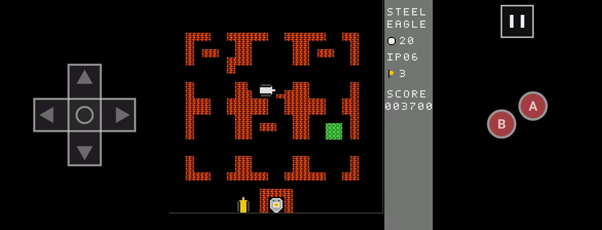
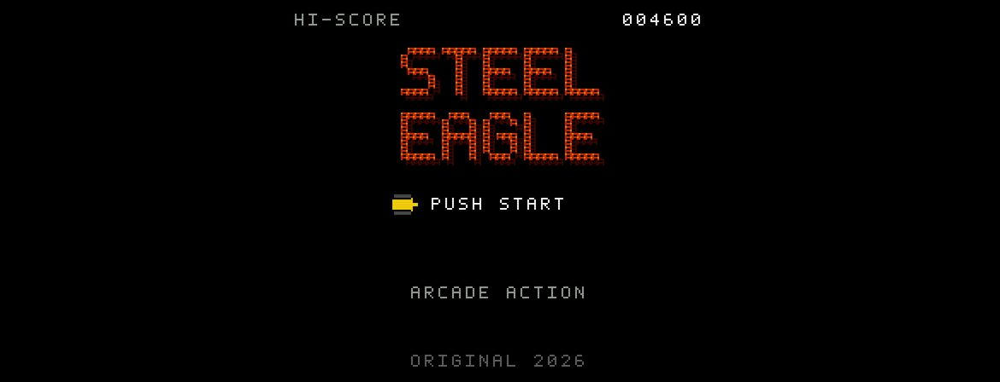
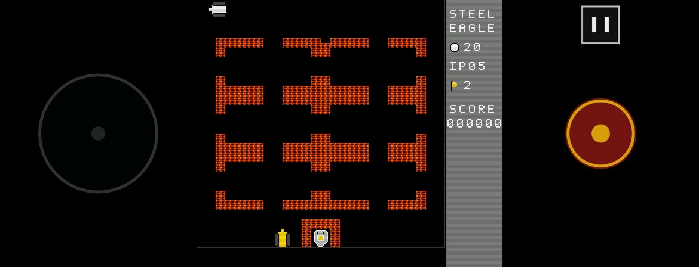
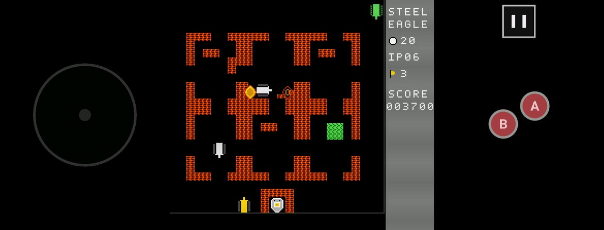
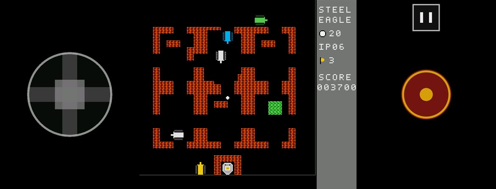
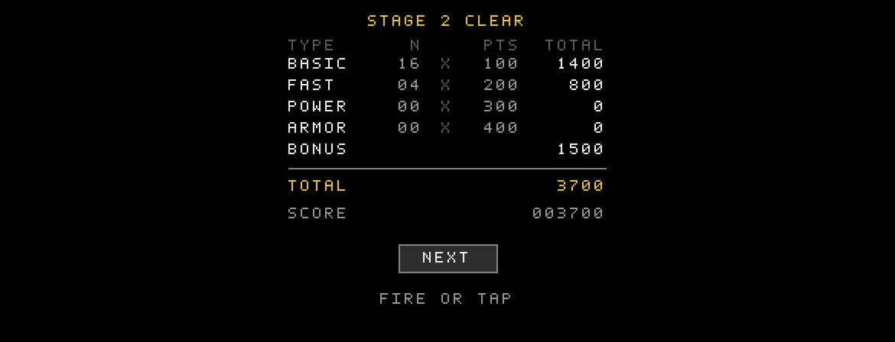
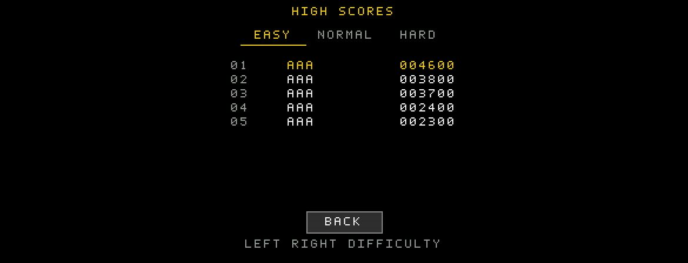
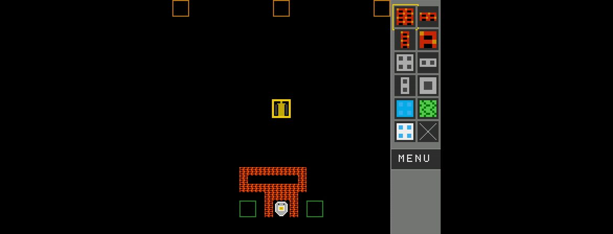
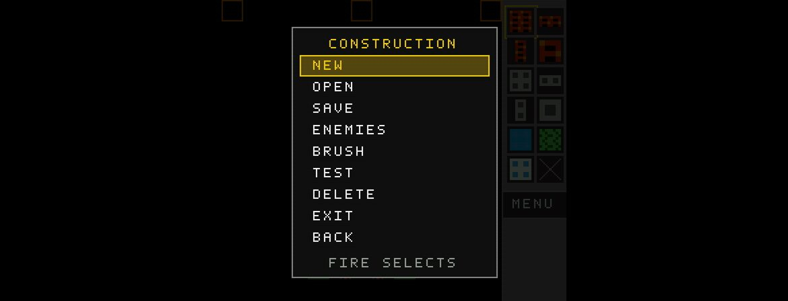
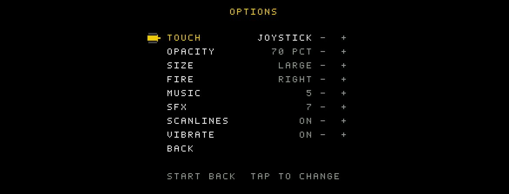

<div align="center">

# Steel Eagle

**A faithful 8-bit tank battle for Android, inspired by *Battle City* / *Tank 1990*.**

Defend the eagle, clear 50 stages, build your own maps and play co-op on one phone or over Wi-Fi.




</div>

---

## Highlights

- **Arcade-accurate feel.** A deterministic 60 Hz simulation in fixed-point units, with grid-aligned turning, brick and steel destruction, ice sliding and the classic enemy roster.
- **50 original stages** across three difficulties, with local high scores for each difficulty and an extra life every 20,000 points.
- **Two players, two ways.** Play on one device with mirrored touch controls, or over the local network with automatic game discovery.
- **Level editor.** Paint bricks, steel, water, trees and ice on a 26×26 field, choose the 20 enemies, then save the map and test it right away.
- **Controls that fit your hands.** Choose a round D-pad, a floating joystick, an NES-style cross pad with A/B, or a joystick with A/B. Game controllers and keyboards work too.
- **Hand-made retro presentation.** Every sprite, the font, the music and the sound effects are original pixel art and real-time synthesis. There is an optional CRT scanline filter.
- **No engine, no AndroidX.** Pure Kotlin on the Android SDK. The app has no runtime dependencies, and the APK is about 1 MB.

## Screenshots

<table>
  <tr>
    <td></td>
    <td></td>
  </tr>
  <tr>
    <td align="center"><sub>Title screen</sub></td>
    <td align="center"><sub>Floating joystick and fire button</sub></td>
  </tr>
  <tr>
    <td></td>
    <td></td>
  </tr>
  <tr>
    <td align="center"><sub>Joystick + A/B</sub></td>
    <td align="center"><sub>Round D-pad</sub></td>
  </tr>
  <tr>
    <td></td>
    <td></td>
  </tr>
  <tr>
    <td align="center"><sub>Stage tally</sub></td>
    <td align="center"><sub>High scores per difficulty</sub></td>
  </tr>
  <tr>
    <td></td>
    <td></td>
  </tr>
  <tr>
    <td align="center"><sub>Construction mode</sub></td>
    <td align="center"><sub>Editor menu: save, open, enemies, test</sub></td>
  </tr>
  <tr>
    <td></td>
    <td></td>
  </tr>
  <tr>
    <td align="center"><sub>Options</sub></td>
    <td align="center"><sub>Same device or local network</sub></td>
  </tr>
</table>

## Gameplay

Guard the eagle at the bottom of the map. Each stage sends 20 enemy tanks, and you clear the stage by destroying all of them. If the eagle is hit, or you run out of lives, the game is over.

| Enemy | Trait |
|---|---|
| Basic | Slow and weak |
| Fast | Moves quickly |
| Power | Fires fast shells |
| Armor | Takes four hits |

Flashing enemies drop a power-up when destroyed:

| Power-up | Effect |
|---|---|
| Star | Upgrades your gun: faster shells, then two shells, then shells that break steel |
| Grenade | Destroys every enemy on screen |
| Helmet | Temporary shield |
| Shovel | Turns the eagle's wall to steel for a while |
| Clock | Freezes all enemies |
| Tank | Extra life |
| Boat | Lets you drive across water |
| Gun | Upgrades your gun to the maximum level at once |

| Difficulty | Lives | Enemies |
|---|---:|---|
| Easy | 5 | Slower, fire less, spawn less often |
| Normal | 3 | Classic pace |
| Hard | 2 | Faster, aggressive, aim for the eagle |

## Game modes

- **1 Player:** the 50-stage campaign. You unlock stages as you go, separately for each difficulty.
- **2 Players, same device:** player 1 controls the left side of the screen and player 2 the right. Player 2 has a green tank. Friendly fire stuns the other tank for about 2 seconds, up to 6 enemies are on screen at once, and the tally gives a +1000 bonus to whoever destroyed more enemies.
- **2 Players, local network:** the host runs the game and the guest plays player 2 over TCP on port `47601`. Games are found automatically through NSD (`_steeleagle._tcp`), or you can type the host's IP. Pause is shared between both players, and a dropped connection returns both to the lobby.
- **Construction:** design a map, set the enemy order, then save it under a name. Your maps appear under **MY LEVELS** on the stage select screen.

## Controls

| Input | Move | Fire | Pause |
|---|---|---|---|
| Touch | D-pad, joystick or NES cross | Fire button, or A / B | On-screen pause button |
| Gamepad | D-pad / left stick | A / B / L1 / R1 | Start |
| Keyboard | Arrows / WASD | Space / Enter | P (Esc / Back goes back) |

Under **Options** you can set the touch layout, control size and opacity, the fire button side (for left-handed play), music and sound volume, the scanline filter and vibration. Connecting a gamepad assigns it to player 1, and a second gamepad goes to player 2. Plugging or unplugging a controller pauses the game.

## Build

Requirements:

- JDK 17 or newer
- Android SDK with platform `android-37.2` (set `ANDROID_HOME`)
- The included Gradle wrapper (Gradle 9.8). You do not need a separate Gradle install.

```bash
export JAVA_HOME=/path/to/jdk17
export ANDROID_HOME=/path/to/android-sdk

./gradlew :app:assembleDebug
adb install -r app/build/outputs/apk/debug/app-debug.apk
```

The app id is `pt.tiago.steeleagle`. It needs Android 8.0 (API 26) or later and targets API 36.

### Tests

```bash
./gradlew :core:test :app:testDebugUnitTest   # 466 JVM tests, no device needed
./gradlew :app:lintDebug
```

The tests cover:

- **`:core`:** the simulation, game rules, enemy AI, level parsing and validation, the editor, the network protocol, and host/guest sync over real sockets on `localhost`.
- **`:app`:** menus, options, touch layouts and quantization, gamepad topology, high scores and the LAN glue code.

## Architecture

The game is split into a pure-Kotlin engine and a thin Android layer:

```
core/   Pure Kotlin/JVM, with no Android imports
  model/    directions, input, fixed-point math
  world/    World: tanks, bullets, terrain, eagle, power-ups, snapshots
  ai/       enemy brain and spawn director
  rules/    difficulty, scoring, enemy and power-up types
  level/    parser, validator, writer, user levels
  editor/   map editing, brushes, enemy roster, editor session
  net/      binary protocol, LanHost, LanClient, terrain deltas
  game/     GameSession: lives, stages, score, events

app/    Android SDK only (no AndroidX)
  render/   256×224 logical bitmap, integer scaling, sprites, font, scanlines
  scene/    PlayScene, EditorScene
  flow/     every screen: menus, tally, options, IP and name entry
  input/    touch pads and joystick, gamepads, keyboard
  net/      NSD discovery and LAN session glue
  audio/    AudioTrack synthesizer, music sequencer, haptics
  storage/  settings, progress and high scores
```

How it works:

- **Rendering:** a dedicated `SurfaceView` thread draws each frame into a 256×224 bitmap and scales it to the screen by a whole-number factor. Touch controls are drawn at full screen resolution on top.
- **Simulation:** the game logic runs on a fixed 60 Hz timestep in 1/16-pixel units, and gives the same result every time from the same inputs. That makes it testable on the JVM and lets the network host stay authoritative.
- **Networking:** the host sends compact binary snapshots and only the terrain cells that changed. The guest sends its input and acknowledges each snapshot.

## Level format

Levels are plain text files: a name, a 20-enemy roster and a 26×26 map.

```
# Steel Eagle level
name: Front Line
enemies: B*14 F*4 P*2
map:
..........................
..BBBB.........BBBB.......
...
```

| Char | Tile |
|---|---|
| `.` | empty |
| `B` | brick |
| `S` | steel |
| `W` | water |
| `T` | trees |
| `I` | ice |

The enemy roster accepts either counts (`B*14 F*4 P*2 A*0`) or an explicit order (`BBBBFF…`). Every level is checked by `LevelValidator`, which verifies free spawn points and that tanks can reach the eagle. Stages 2–50 are produced by [`tools/generate_levels.py`](tools/README.md), which also draws the [preview sheet](tools/preview/levels.md).

## Known limitations

- LAN play has no authentication: anyone on the same network can join an open host.
- Only the host records high scores, and LAN games use campaign stages only.
- There is no host migration or automatic reconnect.
- If Android kills the app, the game in progress and any unsaved editor work are lost. Settings, progress, high scores and saved maps are kept.

## Credits

Inspired by *Battle City* (Namco, 1985) and its *Tank 1990* variant. All graphics, music, sound and levels in this repository are original work. This project is not affiliated with or endorsed by Namco or Bandai Namco.
