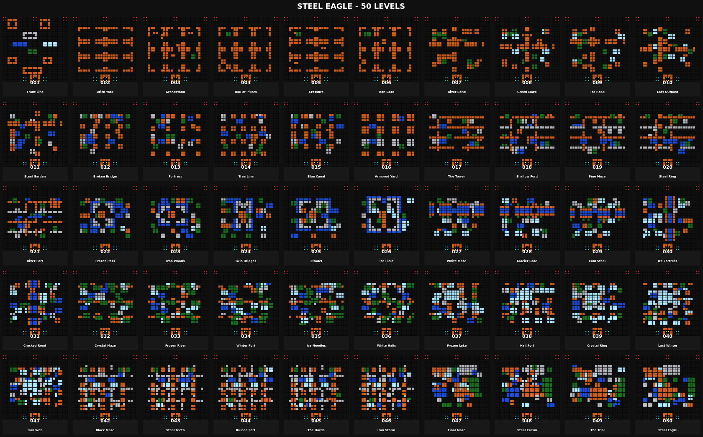

# Steel Eagle - 50 levels

Markers: gold = eagle, cyan = player spawns, red = enemy spawns.

| # | Name | Enemies |
|---:|---|---|
| 001 | Front Line | B*14 F*4 P*2 |
| 002 | Brick Yard | B*16 F*4 |
| 003 | Grandstand | B*12 F*6 P*2 |
| 004 | Hall of Pillars | B*12 F*6 P*2 |
| 005 | Crossfire | B*11 F*6 P*3 |
| 006 | Iron Gate | B*11 F*6 P*3 |
| 007 | River Bend | B*10 F*6 P*4 |
| 008 | Green Maze | B*10 F*6 P*4 |
| 009 | Ice Road | B*9 F*6 P*5 |
| 010 | Last Outpost | B*9 F*6 P*5 |
| 011 | Steel Garden | B*8 F*6 P*6 |
| 012 | Broken Bridge | B*7 F*6 P*7 |
| 013 | Fortress | B*7 F*6 P*7 |
| 014 | Tree Line | B*6 F*6 P*8 |
| 015 | Blue Canal | B*6 F*6 P*8 |
| 016 | Armored Yard | B*6 F*5 P*8 A*1 |
| 017 | The Tower | B*6 F*5 P*8 A*1 |
| 018 | Shallow Ford | B*6 F*5 P*8 A*1 |
| 019 | Pine Maze | B*6 F*5 P*8 A*1 |
| 020 | Steel Ring | B*5 F*5 P*8 A*2 |
| 021 | River Fort | B*5 F*5 P*8 A*2 |
| 022 | Frozen Pass | B*5 F*5 P*8 A*2 |
| 023 | Iron Woods | B*5 F*5 P*8 A*2 |
| 024 | Twin Bridges | B*4 F*5 P*8 A*3 |
| 025 | Citadel | B*4 F*5 P*8 A*3 |
| 026 | Ice Field | B*4 F*4 P*8 A*4 |
| 027 | White Maze | B*4 F*4 P*8 A*4 |
| 028 | Glacier Gate | B*4 F*4 P*8 A*4 |
| 029 | Cold Steel | B*4 F*4 P*8 A*4 |
| 030 | Ice Fortress | B*3 F*4 P*8 A*5 |
| 031 | Cracked Road | B*3 F*4 P*8 A*5 |
| 032 | Crystal Maze | B*3 F*4 P*8 A*5 |
| 033 | Frozen River | B*3 F*4 P*8 A*5 |
| 034 | Winter Fort | B*2 F*4 P*8 A*6 |
| 035 | Ice Needles | B*2 F*4 P*8 A*6 |
| 036 | White Halls | B*2 F*4 P*8 A*6 |
| 037 | Frozen Lake | B*2 F*4 P*8 A*6 |
| 038 | Hail Fort | B*1 F*4 P*8 A*7 |
| 039 | Crystal Ring | B*1 F*4 P*8 A*7 |
| 040 | Last Winter | B*1 F*4 P*8 A*7 |
| 041 | Iron Web | B*2 F*2 P*8 A*8 |
| 042 | Black Maze | B*2 F*2 P*8 A*8 |
| 043 | Steel Teeth | B*2 F*2 P*8 A*8 |
| 044 | Ruined Fort | B*2 F*2 P*8 A*8 |
| 045 | The Horde | B*1 F*2 P*8 A*9 |
| 046 | Iron Storm | B*1 F*2 P*8 A*9 |
| 047 | Final Maze | F*2 P*8 A*10 |
| 048 | Steel Crown | F*2 P*8 A*10 |
| 049 | The Trial | F*1 P*9 A*10 |
| 050 | Steel Eagle | P*10 A*10 |
